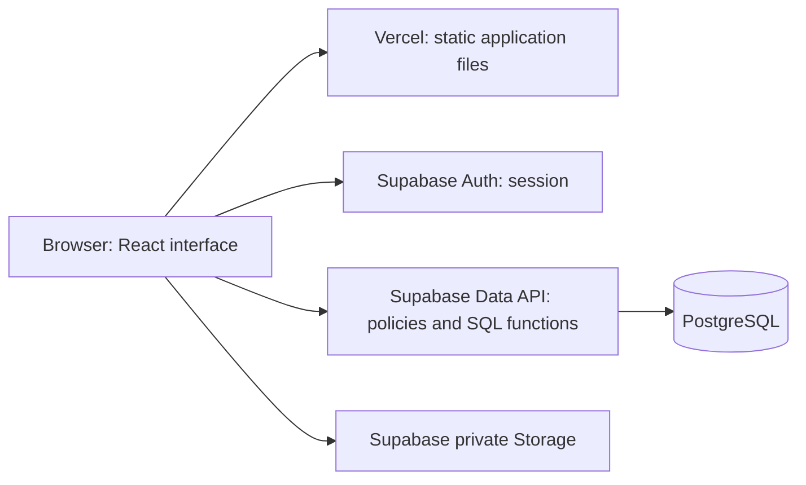
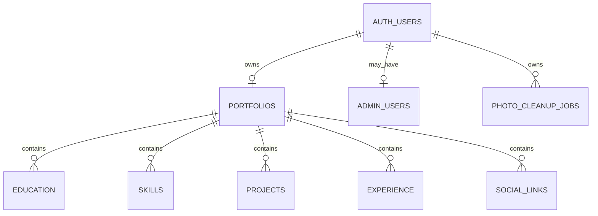
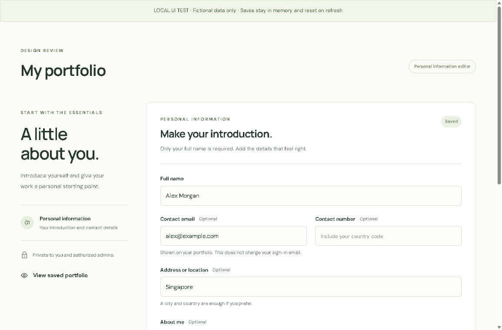
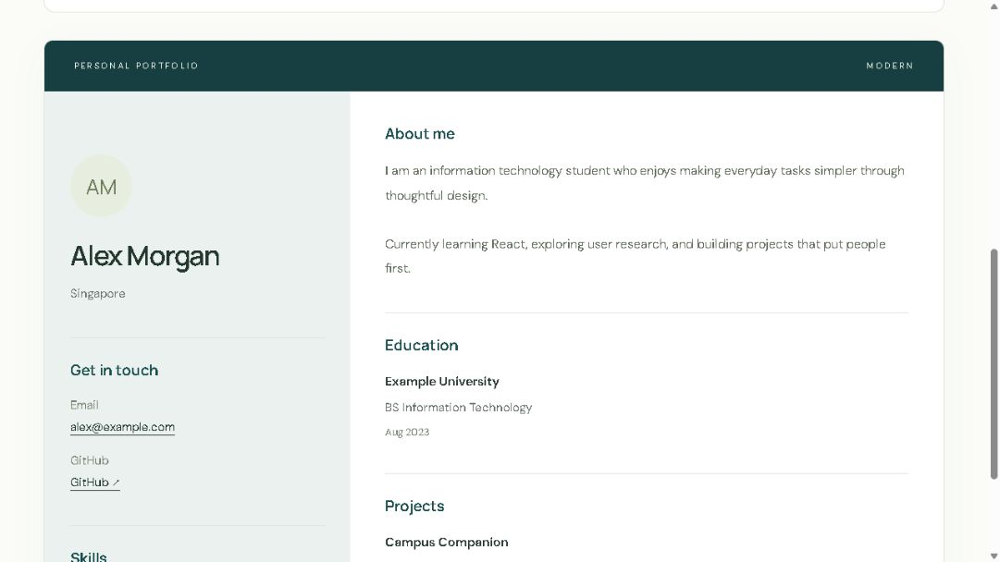
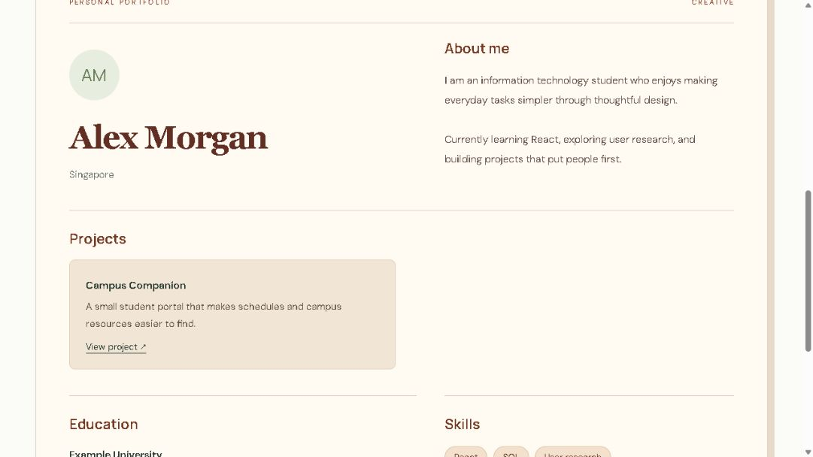

# Portfolio Studio — Project documentation

**Project:** Online Portfolio Template Generator  
**Subjects:** IM / HCI / WST  
**Live website:** https://myfolio-studio.vercel.app/  
**Source repository:** https://github.com/markreeveconsul/Portfolio-Studio  
**Documentation date:** 8 October 2026

## Project description

Portfolio Studio is a database-driven web application for creating and maintaining a personal portfolio. Users enter personal information, education, skills, projects, work experience, and social links, save these details online, and display the same information through five templates: Simple, Modern, Creative, Professional Résumé, and Project Showcase. Users can retrieve, edit, and delete their portfolios.

The application is publicly reachable, while individual portfolios are private to their owner and authorized administrators. Administrators can view other owners' portfolios but cannot edit or delete their information. This privacy model is a project design choice; it does not make users' portfolios public shareable pages.

## Technologies and platforms

| Technology | Responsibility |
| --- | --- |
| React | Reusable interface components and interactive forms |
| TypeScript | Data types and compile-time checks |
| CSS | Responsive layout, typography, focus states, and template styling |
| Vite | Local development and production builds |
| Supabase Auth | Email/password, Google sign-in, sessions, and password recovery |
| PostgreSQL on Supabase | Persistent portfolio records, constraints, transactions, and access policies |
| Supabase Storage | Private profile-photo files |
| Vercel | Hosting the built website over HTTPS |
| GitHub | Source-code repository |
| Vitest / Testing Library | Component and service tests |
| PGlite | Local execution of PostgreSQL migration and policy tests |

**Online database platform:** Supabase (PostgreSQL).  
**Database project:** portfolio_project.  
**Hosting platform:** Vercel.  
**Deployment address:** https://myfolio-studio.vercel.app/

Database passwords, Google client secrets, and service-role keys are excluded from submission materials.

## Scope and features

- Account registration, email confirmation, email/password sign-in, Google sign-in, sign-out, and password recovery.
- One portfolio per account, including optional contact information and an introduction.
- Repeating education, skills, projects, experience, and social-link records.
- Create, retrieve, update, and delete operations backed by the online database.
- Five saved-data templates with separately saved template selection.
- Optional private profile photo with explicit upload, replacement, and removal.
- Owner-only editing and authorized administrator read access.
- Validation, unsaved-change warnings, stale-edit protection, and retryable deletion-photo cleanup.

Public portfolio sharing, PDF export, messaging, and AI-generated content are outside the implemented scope.

## System architecture

Vercel hosts the interface. After authentication, the browser sends requests to Supabase using the project publishable key and the user's session. PostgreSQL row-level security decides which records each request may access. File storage has separate owner/admin policies. Interface restrictions reinforce these rules but do not replace database authorization.

## Database structure

| Table | Main fields and relationships | Purpose |
| --- | --- | --- |
| auth.users | Supabase-managed user ID and identity | Sign-in identity |
| portfolios | id; unique owner_id → auth.users; full_name; email; contact_number; address; cebu_address (JSONB); about_me; photo_path; template; timestamps | One portfolio per owner |
| education | id; portfolio_id; institution; qualification; dates; position | Education records |
| skills | id; portfolio_id; name; position | Ordered skills |
| projects | id; portfolio_id; title; description; project_url; repository_url; position | Project records |
| experience | id; portfolio_id; organization; role_title; description; dates; position | Experience records |
| social_links | id; portfolio_id; label; url; position | Ordered web links |
| private.admin_users | user_id → auth.users; created_at | Trusted administrator membership |
| photo_cleanup_jobs | id; owner_id; photo_path; created_at | Durable pending file deletion |

All five section tables reference portfolios through portfolio_id. Foreign keys cascade child deletion when a portfolio is deleted. The profile-photos bucket stores image bytes separately; portfolios.photo_path stores the object path.

## CRUD and data integrity

Create and update use save_cebu_portfolio, which calls save_portfolio_information and save_personal_information. The function derives the user ID from the session, validates values, and saves the portfolio and sections in a single transaction. A failed section update rolls back the entire operation. Retrieval uses authenticated queries subject to RLS.

The last saved updated_at value is included in updates. A mismatching revision means another session has changed the record; the app rejects the stale write rather than overwrite newer data. Template and photo operations preserve the remaining portfolio content.

Deletion requires typed DELETE confirmation. The deletion function checks owner and revision, deletes the portfolio and its sections, and queues its current photo for cleanup. Storage deletion is a separate operation and can be retried if it fails. The sign-in account is retained.

## Access model

| Actor | Read | Modify |
| --- | --- | --- |
| Signed out | Public homepage and account screens | No portfolio records |
| Owner | Own portfolio and photos | Own portfolio and photos |
| Authorized admin | All portfolios and photos | Own portfolio only |

Administrator membership is assigned using a confirmed Auth user ID in a protected table. It is never taken from editable account metadata. Stored images are downloaded through authenticated access rather than public photo URLs.

## UI and UX decisions

The green-and-cream interface separates editing from saved preview. Simple provides a restrained single-column layout; Modern uses a structured sidebar; Creative uses warm colors, serif headings, and project cards. Labels and optional-field markers help users understand what to enter. Save states, error messages, confirmation controls, and disabled states communicate the result of actions.

Professional Résumé uses compact sections for applications. Project Showcase emphasizes numbered project entries. All five choices have schematic thumbnails; the full saved-data preview is shown after selection. Save changes keeps users in the editor; Save & continue saves and opens preview.

Address coverage includes Cebu province, Cebu City, Mandaue and Lapu-Lapu. City/municipality selection filters the barangays; search is inside the dropdown. Changing city clears barangay and postal code. The bundled snapshot has 53 locations and 1,203 barangays. Legacy free-text addresses are preserved until explicitly converted. Structured addresses show only the city/municipality and country in templates. Phone entry uses +63 with a Philippine flag. See cebu-province-update.md for dataset provenance and snapshot limitations.

Selecting a photo only previews it; Save photo performs the upload. Text changes must be saved before changing a photo. Current supported formats are JPG, PNG, and WebP up to 2 MB. No automatic compression or HEIC conversion is implemented.

The layout adapts at CSS breakpoints. The owner reported successful photo upload on iPhone, confirmed its saved image through the admin account, and subsequently reported two additional successful phone tests. These reports do not establish compatibility with every phone or browser.

## Verification and release status

| Evidence | Result and scope |
| --- | --- |
| Latest local automated UI/service suite | 72 tests passed after the five-template update |
| Latest local database suite | 22 subtests passed; 23 including the enclosing test |
| TypeScript and production build | Passed using temporary local Windows filesystem-resolution overrides; bundle-size advisory remains |
| Deployment | Owner reported completing the upload/migration steps; not an independent full live verification |
| Agent live observation, 8 October 2026 | Signed-out homepage lists all five templates; a stale three-template caption was logged as UX-001 |
| Owner's earlier manual tests | Successful persistence, deletion, recovery, admin checks and phone uploads reported |
| Classmate testing | Invitation and Google Form prepared; no responses imported or analyzed yet |
| Current screenshots | Final authenticated and phone captures deferred to owner |

Manual reports are not presented as independently repeated tests. Signed-out route checks alone do not prove database isolation. The separate read-only deployment inventory checks schema configuration, while access-control assertions test database behavior.

## Screenshots and evidence

The following images are existing development captures using fictional data. They illustrate interface design, not proof of hosted persistence. Keep these captions if reusing them.

### Information editor

### Modern template

### Creative template

### Final screenshot work

The owner will capture final screenshots later. Use screenshot-checklist.md for the complete capture list, including all five templates, the editor, and mobile views. Existing images above are older development references, not current release evidence. Never include passwords, reset tokens, or secret keys.

## Deployment and maintenance

GitHub stores the code and Vercel builds the selected branch. Production environment variables are VITE_SUPABASE_URL and VITE_SUPABASE_PUBLISHABLE_KEY. Supabase allows production callbacks for account confirmation, Google return, and recovery. Keep local callback URLs for development. Apply each database migration only once and preserve RLS.

The website does not depend on the developer's PowerShell server. Future code changes must be committed to GitHub and built by Vercel before they affect the live website. Local edits alone do not update production.

## Known limitations

The early mobile picker complaint was not reproduced consistently and later phone tests succeeded. Its cause remains unconfirmed. The updated photo picker is included in the latest release package, but a new device check is still needed. Keep the release stable during this classmate feedback round. Photo uploads left unreferenced after ambiguous save responses may require administrator cleanup; the deletion queue handles the current photo of a deleted portfolio, not every historical orphan.

The repository is private, so source submission requires an instructor-approved access method or a clean source archive. Personal portfolios require sign-in; give the instructor clear account setup instructions. Do not share your own administrator password.

## Database migration history

| Migration | Purpose |
| --- | --- |
| 001_foundation | Tables, relationships, admin membership, access policies and private photo storage |
| 002_personal_information | Atomic personal/link saves and stale-revision protection |
| 003_portfolio_sections | Save education, skills, projects and experience in the same transaction |
| 004_portfolio_deletion | Owner/revision-checked deletion and durable photo-cleanup jobs |
| 005_cebu_contact | Structured Cebu City addresses and a coordinated save function |
| 006_cebu_province | Wider Cebu coverage, valid city/barangay pairs, legacy compatibility |
| 007_professional_templates | Permit resume and showcase as stored template values |

Apply migrations once in order. Manual SQL Editor execution is not automatically tracked by the filenames. UI-only changes such as the flag do not require database migrations. See migrations-guide.md for an explanation.

## Usability evaluation

Invite classmates to sign in, save information, upload a photo, choose a template and verify persistence after refresh. Record device/browser, task outcomes and confusion in the feedback tracker. Ratings are descriptive feedback, not a validated usability score. No classmate findings or satisfaction figures are claimed until actual responses are reviewed. The deeper security review remains deferred by the owner; this report is not a security certification.
